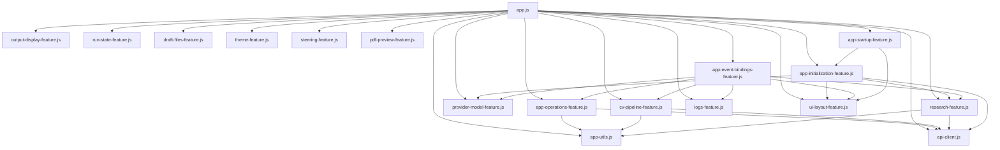

# Frontend Architecture Map

This document summarizes the frontend module structure under `cv_web/static`.

## High-Level Structure

- `app.js` is the composition root.
- Feature modules under `static/js` hold domain behavior.
- Shared utilities (`api-client.js`, `app-utils.js`) provide infrastructure helpers.

## Dependency Flow



## Module Responsibilities

### Composition Root

- `app.js`
  - Creates shared state and DOM registry.
  - Instantiates feature modules and wires dependencies.
  - Triggers event binding and startup sequence.

### Infrastructure

- `api-client.js`
  - JSON and text fetch helpers with consistent error behavior.

- `app-utils.js`
  - Shared pure helpers (command formatting, timestamp formatting, sleep, URL parsing).

### Presentation and Interaction

- `output-display-feature.js`
  - Renders status, run/research outputs, and smart auto-scroll behavior.

- `pdf-preview-feature.js`
  - Manages CV/Research PDF preview state and iframe/link rendering.

- `ui-layout-feature.js`
  - Controls tab activation, splitter interactions, and layout persistence.

- `app-event-bindings-feature.js`
  - Attaches UI events to feature APIs.

### Workflow and Orchestration

- `run-state-feature.js`
  - Tracks running flags, run timer, control disabled state, and research primary button state.

- `draft-files-feature.js`
  - Manages editor values, dirty indicators, local draft persistence, and mirrored editors.

- `provider-model-feature.js`
  - Manages provider/model selectors, option normalization, and selection persistence.

- `theme-feature.js`
  - Fills the CV-tab PDF theme selector from `/api/state` `themes` (the `themes/*.typ` presets), persists the choice,
    and re-runs formatting only when it changes.

- `steering-feature.js`
  - Keeps the Steering tab text and the "Steer CV generation" checkbox in localStorage and builds the `steering`
    object (`{enabled, text}`) that full runs send.

- `app-operations-feature.js`
  - Handles file save/load/reload, tailored output refresh, and server restart flow.

- `cv-pipeline-feature.js`
  - Starts CV pipeline runs, polls status, and coordinates post-run refreshes.

- `research-feature.js`
  - Runs/stops/formats research and updates research state through callbacks.

- `logs-feature.js`
  - Fetches log index and selected debug log content.

- `app-initialization-feature.js`
  - Loads initial API state, restores local draft and tabs, restores research runtime state.

- `app-startup-feature.js`
  - Executes final startup order (autosave binding, mirrored editors, layout init, initialize).

## API Endpoint Ownership

This map identifies which frontend feature owns each backend/static endpoint interaction.

| Endpoint or Path | Owner Module | Purpose |
|---|---|---|
| `/api/state` | `app-initialization-feature.js`, `app-operations-feature.js`, `cv-pipeline-feature.js`, `research-feature.js` | Load baseline editor/output state and refresh snapshots after operations. |
| `/api/save` | `app-operations-feature.js` | Persist one file or all editable files. |
| `/api/server/restart` | `app-operations-feature.js` | Restart backend server and poll for readiness. |
| `/api/run/status` | `cv-pipeline-feature.js` | Poll active CV pipeline run status. |
| `/api/run/full` | `cv-pipeline-feature.js` | Start full CV pipeline run. |
| `/api/run/format` | `cv-pipeline-feature.js` | Start CV formatting-only run. |
| `/api/logs` | `logs-feature.js` | Load log index and last-run metadata. |
| `/api/logs/content` | `logs-feature.js` | Load selected debug log content. |
| `/api/research/state` | `app-initialization-feature.js`, `research-feature.js` | Load research output/state snapshots. |
| `/api/research/status` | `research-feature.js` | Poll research run status. |
| `/api/research/run` | `research-feature.js` | Start research run. |
| `/api/research/stop` | `research-feature.js` | Request stop for active research run. |
| `/api/research/format` | `research-feature.js` | Format research PDF output. |
| `/api/research/reset-prompt` | `research-feature.js` | Restore default research prompt file. |
| `/output/tailored.md` | `app-operations-feature.js` | Load tailored markdown output into viewer. |

## app.js Composition Walkthrough

`app.js` acts as a declarative composition script, not a feature implementation file.

### 1. Build shared primitives

- Creates shared mutable state (`state`) used by multiple features.
- Captures stable DOM references once (`els`) to avoid repetitive `document.getElementById` calls.
- Defines static maps (`EDITABLE_FILES`, `LS_KEYS`) that are injected into features.

### 2. Build foundational features first

- `pdf-preview-feature.js`
- `output-display-feature.js`
- `run-state-feature.js`
- `draft-files-feature.js`

These features expose callbacks needed by higher-level workflow modules.

### 3. Build workflow features with injected callbacks

- `app-operations-feature.js`
- `research-feature.js`
- `logs-feature.js`
- `provider-model-feature.js`
- `theme-feature.js`
- `steering-feature.js`
- `cv-pipeline-feature.js`

These modules orchestrate backend operations but do not query the DOM directly.

### 4. Build orchestration wrappers

- `app-initialization-feature.js` restores API/local startup state.
- `app-event-bindings-feature.js` attaches DOM events to feature APIs.
- `app-startup-feature.js` executes one-time startup order.

### 5. Launch app in two explicit calls

1. `bindEventHandlers()`
2. `runStartupSequence()`

This keeps startup behavior easy to reason about and prevents hidden side effects.

## Runtime Sequence

1. `app.js` creates features.
2. `app-event-bindings-feature.js` binds UI events.
3. `app-startup-feature.js` runs startup sequence.
4. `app-initialization-feature.js` loads API/local state and restores UI.

## Appendix: Backend Reference

The backend entrypoint has been decomposed into focused modules under `cv_web`.

| Module | Responsibility |
|---|---|
| `server.py` | Composition root and HTTP server startup. Exposes compatibility wrappers and wires dependencies into extracted modules. |
| `server_http_handlers.py` | Route dispatch and HTTP action handlers for GET/POST API/static endpoints. |
| `server_process_runners.py` | Subprocess execution, stdout/stderr streaming, async wrappers, and run finalization orchestration. |
| `server_state_helpers.py` | State payload builders, shared file I/O helpers, and debug log index/content helpers. |
| `server_request_parsing.py` | Request payload/dataclass parsing and provider/model normalization. |
| `server_run_helpers.py` | Command builders and run-state payload shape builders. |
| `server_runtime_state.py` | Mutable runtime state ownership, locks, snapshots, mutation/finalization helpers, and stop handling. |

### Backend Dependency Direction

```mermaid
flowchart TD
  Server[server.py]\ncomposition root
  Http[server_http_handlers.py]
  Proc[server_process_runners.py]
  State[server_state_helpers.py]
  Parse[server_request_parsing.py]
  RunHelpers[server_run_helpers.py]
  Runtime[server_runtime_state.py]

  Server --> Http
  Server --> Proc
  Server --> State
  Server --> Parse
  Server --> RunHelpers
  Server --> Runtime

  Http --> Parse
  Http --> State
  Http --> Proc
  Http --> Runtime

  Proc --> RunHelpers
  Proc --> Runtime

  State --> Parse
  State --> Runtime
```

## Notes for Future Changes

- Prefer adding behavior to an existing feature module before extending `app.js`.
- Keep dependencies injected via context objects to preserve testability and module boundaries.
- Keep user-facing text centralized in the owning feature when practical.

## How To Add A New Feature Module

Use this checklist when introducing a new frontend feature under `static/js`.

1. Create the module file with a clear name, for example `something-feature.js`.
2. Add a file header with:
  - `Architecture role`
  - `Plain-language purpose`
3. Define a context typedef describing injected dependencies.
4. Expose a single factory, typically `createXFeature(ctx)`.
5. Keep DOM querying out of the feature where possible; pass required elements through `els`.
6. Keep API access through injected helpers (`api`, `fetchText`) instead of direct global fetch calls.
7. Return a small public API object with only methods needed by other modules.
8. In `app.js`, instantiate the feature in composition order:
  - foundational utilities/presentation first
  - workflow features next
  - orchestration features last
9. Wire new handlers in `app-event-bindings-feature.js` rather than adding listener code directly in `app.js`.
10. If the feature participates in startup behavior, integrate it through `app-initialization-feature.js` or `app-startup-feature.js`.
11. Update this architecture document:
  - add module to the dependency flow section if needed
  - add module responsibility bullet
  - add endpoint ownership entries if it calls new endpoints
12. Run validation:
  - editor diagnostics for changed files
  - runtime smoke check for static file serving and relevant API endpoints
