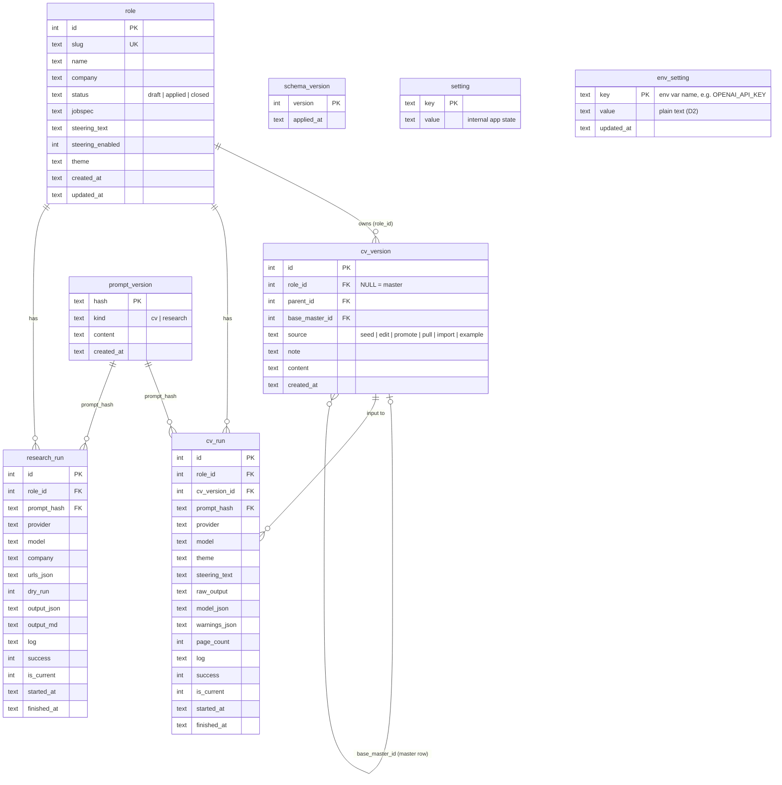

# Database schema

The SQLite DB (`cv_web/resumator.db`) is defined only by the append-only `store.MIGRATIONS` in
[cv_web/store.py](../cv_web/store.py). **Keep this page in step with it:** any change to a migration list entry
updates the diagram and the table below in the same change (see "Doc upkeep" in [AGENTS.md](../AGENTS.md)).
Design background: [plans/multi-role-design.md](plans/multi-role-design.md) (roles, R1–R21) and
[plans/settings-in-db/design.md](plans/settings-in-db/design.md) (settings, D1–D11).

**Schema version:** 2 (migrations: 1 = roles, CVs, runs, `setting`; 2 = `env_setting`).

## ER diagram

`schema_version` stands alone (one row per applied migration) and is shown in the diagram only for completeness.

## Tables

| Table | Holds | Notes |
|---|---|---|
| `schema_version` | Applied migrations | Written by `store.migrate` |
| `role` | One job application | `slug` unique; `status` draft/applied/closed (archive = closed, R21) |
| `cv_version` | Every saved CV text, master and per role | `role_id` NULL = master (R8); `parent_id` chains versions; `base_master_id` is the merge ancestor |
| `prompt_version` | Prompt templates by SHA-256 | Runs reference them by hash (R15) |
| `cv_run`, `research_run` | One pipeline run each, failures included | At most one `is_current` per role (partial unique index); `*_json` columns are `json_valid` checked |
| `setting` | Internal app state | `first_run_done`, `role_merge` import base, ... Not user config |
| `env_setting` | User config: the keys that used to live in `.env` | Key format CHECK; secrets are plain text for now (D2). Catalog and meaning of keys live in code (`settings_catalog.py`) |

Rules enforced in code rather than SQL: a role's `base_master_id` points at a master row; a CV run's
`cv_version_id` belongs to the same role. Connections: autocommit, `foreign_keys = ON`, WAL, `busy_timeout` 5 s.
