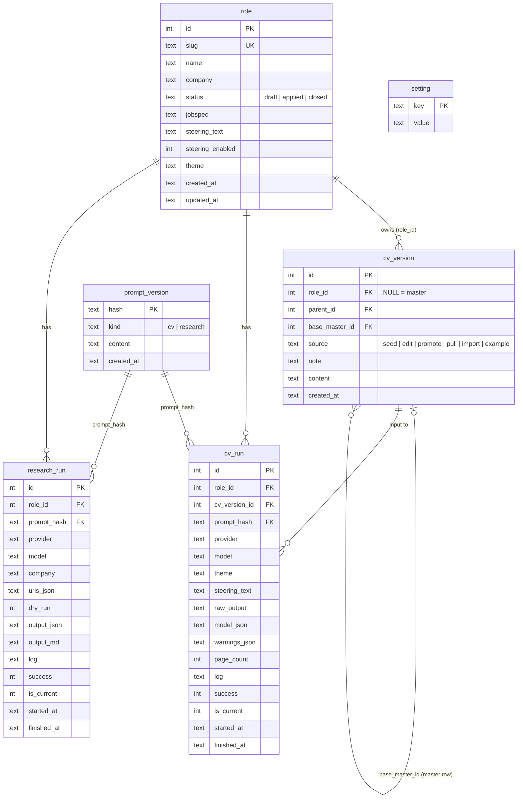

# Plan: multi-role workspace (TODO — design agreed, not started)

**Goal:** keep several job applications ("roles") side by side. Each role has its own job spec, steering, CV runs and
research runs. A sidebar lists the roles, with a **+** to create one, and a new role can start from a copy of the
canonical master CV. Storage moves to a small database. Only agent-returned text is stored; PDFs are rendered on
demand.

**Status:** TODO. Design agreed (R1–R20); nothing built. Next: stage S1, starting with the step 1 spike.
Work happens on branch `feature/20261021-multi-role` (from `develop`).

## Decisions

| # | Decision | Why |
|---|---|---|
| R1 | **Every role has its own CV, seeded from the master** when the role is created, then freely editable (for example to remove a previous employer or sensitive details). A role can **promote** its CV (or edits) to the master at any time, so edits can flow both ways | Your call. The master stays the best "everything" record; roles tailor what's disclosed |
| R2 | **No cross-role copying** for now; copy and paste covers it | Your call. Keeps the model simple |
| R3 | **First run** for a new user: example data or blank. No general "import existing" option | Your call. Most users have no single-role history to bring over |
| R4 | **One-time migration for the current install** (a CLI command, not a UI path): today's files become the first role, including the current research output | Your call. It's a one-off move from single-role to multi-role |
| R5 | **CLI keeps today's one-shot, file-based generation** and adds role mode: `--role "Name" --action cv|research|…` | Your call. Scripting and quick runs stay possible without the DB |
| R6 | **Only agent-returned text is stored**; PDFs are rendered on demand | Your call (original brief) |
| R7 | **Changes between master and role CVs are diffed and merged, never overwritten.** Information removed from a role stays in the master | Your call. A role's deliberate removals must not delete facts from the master |
| R8 | **The master CV is versioned in the DB**, alongside the role CVs: every save, promotion or merge adds a version with its date and source | Your call. Gives history, undo, and the common ancestor that merges need |
| R9 | **The DB sits beside the main server file:** `cv_web/resumator.db`, gitignored | Your call, "for now". Easy to move later behind one path constant |
| R10 | **The DB is the master's record; `input/CV.md` is not kept in sync.** It stays as the migration source and the one-shot CLI's default input. No export on save | Your call. Git already holds the file's history |
| R11 | **Merges work on whole entries** (`##` roles, projects, qualifications) and whole sections, not line hunks | Your call, "for now". Matches how CVs are edited and keeps the promote view readable |
| R12 | **Manual "Import `input/CV.md` as master"** action: runs the file through the same merge view (base = the master version it was last imported from) and saves a new master version with `source = import` | Your call. Covers hand edits to the file after migration; cheap given the merge engine |
| R13 | **SQLite now** (stdlib `sqlite3`, JSON in TEXT columns), not files-per-role first | R7/R8 need versions and merge ancestors, which are DB-shaped; files first would mean building twice |
| R14 | **Role runs wrap the existing scripts, talking over pipes, not files.** A JSON request goes in on stdin and a JSON result comes out on stdout; progress goes to stderr. No `input/` or `output/` data files are read or written in this mode (see "Run I/O") | Your call. Scripts stay DB-free, one-shot file mode is unchanged (R5), and the server and role CLI share one runner |
| R15 | **Each run stores the full prompt text, deduplicated by hash** in a `prompt_version` table | Your call. Runs stay reproducible even when `prompt.md` was edited but not committed |
| R16 | **PDFs: warm + on demand.** The run returns its PDF for the run's own theme, which goes straight into the cache; other themes render on first view. The cache is in server memory, keyed by run, theme and format, and lost on restart | Your call. No PDFs stored (R6), no files written, and the common view is instant |
| R17 | **Staged build: roles first, merge later** (S1–S4 below). Side-by-side roles are usable after S2; promote/pull arrive in S3 | Your call. Value early; the merge engine is still built and tested in S1 |
| R18 | **Backup is a `backup` command** that uses SQLite's online backup API to write a timestamped copy of the DB. Per-role JSON export only if needed later | Proposed default, not objected to |
| R19 | **Directives travel with each role's CV**, so they are already per role. Nothing extra | Proposed default, not objected to |
| R20 | **Role list: name, company, status (`draft`, `applied`, `closed`) and last-updated date.** No tracker features | Proposed default, not objected to |

## Today (what this replaces)

Everything is single-role and file-based:

| Data | Where it lives now |
|---|---|
| Master CV | `input/CV.md` (canonical, in git) |
| Job spec | `input/jobspec.txt` (one at a time; currently the Quantum Base Lead Mobile Engineer spec, uncommitted) |
| CV prompt, research prompt | `input/prompt.md`, `input/research_prompt.md` |
| Steering, steer toggle, theme | Browser localStorage (`cvweb.steering_text`, `cvweb.steering_enabled`, `cvweb.selected_theme`) |
| CV run output | `output/tailored.model-output.txt` (raw), `tailored.model.json` (validated, plus `metadata`), `tailored.md`, PDF/DOCX. Overwritten each run |
| Research inputs | `input/research_company.txt`, `input/research_urls.txt` |
| Research output | `output/research_output.json` / `.md`, formatted PDF. Overwritten each run (currently a "Bridge Probe" test) |
| Older runs | Ad hoc copies: `output/baseline-gemini-2.5-flash/`, `output/step8-opus-fastmode/`, `output/step9-opus/` |

Constraints to keep (AGENTS.md): Python stdlib only, vanilla-JS UI, external tools only via subprocess.

## Concepts (draft)

- **Master CV:** the canonical, complete CV. It's versioned in the DB (R8), which is its record; `input/CV.md` is
  imported once and not kept in sync (R10). It seeds every new role's CV, and any role can merge changes back into it (R1, R7).
- **Role:** one application. It has a name, a company, the job spec text, a status (for example draft, applied,
  closed) and timestamps.
- **Role CV:** every role's own CV, copied from the master when the role is created and then edited independently
  (R1). Runs always use the role's CV. Each role CV remembers the master version it was seeded from or last synced
  with: its **base**. Two sync actions, both three-way merges against that base (R7):
  - **Promote to master** (role → master): the role's changes since the base are shown per entry (R11). The user
    picks which to apply. Removals are unticked by default, so information isn't lost from the master.
  - **Pull from master** (master → role): the master's changes since the base are merged into the role. The role's
    own edits, including removals, survive. Conflicts are shown for the user to resolve.
- **CV run:** one generation for a role. It records the inputs actually sent: provider, model, steering text and
  enabled flag, theme, the prompt version, and a CV snapshot or hash. It also stores the agent output: raw text plus
  validated JSON with `metadata` (warnings, page count). Each role keeps a history of runs; one is "current".
- **Research run:** one research generation for a role. Inputs are the company, URLs and dry-run flag; the output is
  the research JSON/markdown.
- **Rendered output:** the PDF/DOCX made from a run's JSON (`render_tagged_markdown` → `cv_convert`) with the
  chosen theme, held in the server's memory cache and treated as disposable (R16).

## Storage options

| Option | Fit | Notes |
|---|---|---|
| **SQLite (stdlib `sqlite3`), JSON in TEXT columns** — recommended | Strong | No new dependency. One file (`cv_web/resumator.db`, gitignored; R9). Relational tables for roles and runs, plus the agent JSON stored whole and queryable with SQLite's JSON functions. "SQL plus documents" in one store, with room to grow |
| JSON/markdown files per role (`roles/<slug>/…`) | OK for now | Git-friendly and readable, but listing, history and querying become hand-written code, and concurrent writes are fragile |
| Document DB (TinyDB, MongoDB…) | Poor | Third-party dependency or server; breaks the stdlib invariant for little gain |
| Postgres | Overkill | Server to run; only worth it for multi-user hosting |

**Decided (R13):** SQLite for roles, CV versions (master and role), runs, prompt versions and settings. Prompt
*templates* stay files in git; each run stores the text it actually used (R15). Schema migrations: a `schema_version`
table plus ordered SQL scripts applied on startup.

### CV versions: one table, not a separate master table or `isMaster` flag

Master and role CVs are the same kind of thing (CV source text with history), so one `cv_version` table holds both:

- `role_id NULL` means master. A separate `is_master` flag would only repeat that and could disagree with it; a
  view or helper can expose `is_master` for readability.
- Rows are append-only: an edit, promotion or merge adds a row rather than updating one. The current CV of a role
  (or of the master) is its newest row.
- `parent_id` links each version to the one it came from. `base_master_id` (on role versions) records the master
  version it was last synced with. That's the common ancestor a three-way merge needs (R7).
- `source` records how the version was made: `seed`, `edit`, `promote`, `pull`, `import` or `example`.
- Merging is entry-level (R11). `cv_source.py` already parses the CV into sections and `##` entries, so each side
  becomes a map keyed by section and entry heading. A three-way comparison (base vs role vs master) classifies each
  entry as unchanged, added, removed or changed on one side, or changed on both (a conflict). A change applies as
  the whole entry; a conflict asks the user to pick one side or edit. Prose sections (Profile) and field sections
  (Candidate, Skills, Directives) count as single units. `difflib` is used only to show what changed inside an
  entry. A renamed heading looks like a removal plus an addition; that's acceptable for now.

### Sketch schema (to refine)

```sql
role(id, slug, name, company, status, jobspec TEXT,
     steering_text TEXT, steering_enabled INT, theme TEXT, created_at, updated_at)
cv_version(id, role_id NULL,          -- NULL = master (R8)
           parent_id NULL,            -- previous version of the same CV
           base_master_id NULL,       -- role versions: master version last synced with (merge ancestor)
           source,                    -- seed | edit | promote | pull | import | example
           note NULL, content TEXT, created_at)
prompt_version(hash PRIMARY KEY, kind, content TEXT, created_at)  -- kind: cv | research (R15)
cv_run(id, role_id, cv_version_id,    -- the exact CV text the agent saw
       started_at, finished_at, provider, model, theme, steering_text NULL,
       prompt_hash, raw_output TEXT, model_json TEXT, warnings_json TEXT, page_count INT,
       log TEXT, success INT, is_current INT)
research_run(id, role_id, started_at, finished_at, provider, model, prompt_hash, company, urls_json, dry_run INT,
             output_json TEXT, output_md TEXT, log TEXT, success INT, is_current INT)
setting(key, value)  -- e.g. last_role_id, first_run_done
```



Keep this diagram in step with the SQL as the schema is refined. DB steps show the current diagram inline when
proposing or reporting schema changes.

The streamed run log (what the UI shows live) is saved in the run's `log` column. Failed runs are kept too
(`success = 0`), so a failure can be inspected later; they are never "current".

## Run I/O: pipes, not files (R14)

Both scripts gain one flag, `--io json`. Without it they behave exactly as today (R5). With it:

| Channel | Content |
|---|---|
| stdin | One JSON request. CV: `{cv, jobspec, steering, prompt, theme, provider, model}`. Research: `{cv, prompt, company, urls, provider, model, dry_run}` |
| stderr | Progress lines, streamed live to the UI as today |
| stdout | One JSON result, written at the end. CV: `{success, provider, model, raw_output, model_json, warnings, page_count, pdf_base64, error}`. Research: `{success, provider, model, output_json, output_md, error}` |
| exit code | 0 on success; non-zero still writes a result with `error` when it can |

- **`role_runner.py`** (new, beside the server) is the one place that builds a request from the DB, runs the
  script, streams its stderr, parses the result and saves the run row. The server and the role CLI both call it.
  It stores the prompt text from the request in `prompt_version` (R15).
- **Rendering in memory:** `cv_convert` gains a function that takes tagged markdown and a theme and returns PDF
  or DOCX bytes, piping through `pandoc` and `typst` (stdin/stdout, `--root` at the repo for theme files). Page
  counting (step 9's page-fit check) uses those bytes, and the same PDF comes back as `pdf_base64` to warm the
  server's cache (R16). The one-shot mode keeps writing `output/` files as now.
- **What still touches disk:** read-only repo files (prompt templates, `themes/`), and the DB itself. Provider
  attempt logs (`output/gemini_debug_logs/`) are not written in `--io json` mode; their content goes to stderr,
  so it ends up in the run's `log`. `research_role` stops writing its inputs back to `input/` in this mode.
- **Server change:** the server already reads stdout and stderr on threads. In `--io json` mode stderr is the live
  log and stdout is collected whole as the result, not streamed.

## UI (draft)

- **Left sidebar:** a list of roles (name, company, last run date, steered marker). **+** creates a role (name,
  company, paste job spec); its CV starts as a copy of the master (R1). Selecting a role loads its CV, job spec,
  steering, theme, runs and research into the existing tabs.
- **Per-role controls:** steering (moves from localStorage to the role), theme, run history dropdown (pick which
  run's PDF to view), archive and delete role.
- The CV tab edits the role's CV, with **Promote to master** and **Pull from master** actions. Both open a merge view
  (one checkbox per changed entry, conflicts highlighted, with an inline diff) before anything is saved (R7, R11). The master can also be opened
  and edited directly, with its version history. The UI must make clear which CV is open.
- The Research tab is scoped to the selected role.
- The PDF preview renders the selected run on the fly. The 🧭 marker comes from that run's `steering_text`.

## First-run behaviour (R3)

On startup with no database (or an empty one):

1. Create the schema.
2. Ask the user to choose: **example data** (a sample role with a short job spec, a sample master CV and a canned
   run, also useful for demos and tests) or **blank** (an empty master CV template, no roles).
3. Record `first_run_done` so the choice isn't offered again.

## One-time migration of this install (R4)

A CLI command, for example `python3 -m resumator migrate-single-role --name "Quantum Base"`, run once:

- The master CV is imported from `input/CV.md` as master version 1 (`source = import`).
- A role is created from `input/jobspec.txt` (Quantum Base, Lead Mobile Engineer), with its CV seeded from the
  master.
- CV runs: the current `output/tailored.model-output.txt` and `tailored.model.json` (with metadata and steering)
  become its current run. The archived `output/step9-opus/` and `output/step8-opus-fastmode/` are optionally kept
  as history.
- Research: `output/research_output.json` and `.md` are imported into this role, with `input/research_company.txt`
  and `research_urls.txt` as its inputs.
- Steering and theme live in browser localStorage, which the CLI can't read. The UI copies them into the selected
  role on its first load after the migration, if the role has none.
- The command is idempotent: it refuses or skips when the role already exists.

## CLI (R5)

- **One-shot, file-based (unchanged):** `python3 generate_cv.py [--cv …] [--steering-file …] …` and
  `research_role.py` read `input/` and write `output/`, with no DB involved.
- **Role mode:** a single entry point, for example `python3 -m resumator --role "Quantum Base" --action cv` (or
  `research`, `render`, `list`, `create`…). It reads the role's CV, job spec, steering and theme from the DB and
  saves the run back. The existing flags (`--provider`, `--model`, `--theme`, `--no-steering`) override the role's
  settings for that run.
- Role mode wraps the scripts through `role_runner.py` over pipes (R14); the scripts never see the DB.
- `backup` (R18) and `migrate-single-role` (R4) are actions of the same entry point.

## Stages and steps

Each stage ends with the app working and tests passing. One-shot CLI behaviour is unchanged throughout.

**S1 — Foundations** (no visible change to the UI)

| # | Step | Output | Status |
|---|---|---|---|
| 1 | Spike: `pandoc` → `typst` over stdin/stdout with a theme (`--root`), PDF bytes and page count, and timing; SQLite JSON functions over the current `tailored.model.json`. Confirm or adjust R14/R16 | Spike notes in the log | todo |
| 2 | `store.py`: connect, migrations (`schema_version`), CRUD for role, cv_version, prompt_version, cv_run, research_run, setting; `backup` (R18). Tests on a temp DB | Data layer | todo |
| 3 | `cv_merge.py`: entry-level three-way merge on `cv_source` parses (R11), rebuilding the CV text. Tests | Merge engine (not wired yet) | todo |
| 4 | In-memory render function in `cv_convert` (markdown + theme → PDF/DOCX bytes) | Render without files | todo |
| 5 | `--io json` mode for `generate_cv` and `research_role` (R14). Contract tests: request in, result out, nothing written to `input/` or `output/` | Pipe mode | todo |

**S2 — Usable roles** (side-by-side applications)

| # | Step | Output | Status |
|---|---|---|---|
| 6 | `role_runner.py`: request from DB → script → result → run row, prompt saved (R15), log saved | Runs persisted | todo |
| 7 | Migration command (R4); run it on this install: master v1 from `input/CV.md`, Quantum Base role, current and archived CV runs, current research | Migrated | todo |
| 8 | Server API: `/api/roles` (list, create, update, archive, delete), `/api/roles/<id>/cv` (read, save as a new version), runs (list, select current, start), PDF/DOCX of a run and theme through the memory cache (R16); existing endpoints scoped to a role | API | todo |
| 9 | UI: sidebar with **+**, role switching, CV tab edits the role CV, master opened and edited directly (no merge yet), steering and theme per role (one-time copy from localStorage), run-history picker | Roles usable | todo |

**S3 — Master versions and merge**

| # | Step | Output | Status |
|---|---|---|---|
| 10 | Promote and pull: merge view (one checkbox per entry, removals unticked by default, conflicts highlighted, inline `difflib` diff) over the S1 engine (R7, R11) | Two-way sync | todo |
| 11 | Master version history (view and restore as a new version) and "Import `input/CV.md` as master" (R12) | History and import | todo |

**S4 — Finish**

| # | Step | Output | Status |
|---|---|---|---|
| 12 | First-run flow: example data or blank (R3) | First run | todo |
| 13 | Role-mode CLI: `python3 -m resumator --role … --action cv|research|render|list|create|backup` | CLI | todo |
| 14 | Docs: architecture, cv-format, AGENTS.md, gaps; retire the single-file assumptions | Docs in sync | todo |

## Between steps: stay or start a new session

At the end of every step, the agent updates the step's status, the Log and the Handoff, then tells the user one of
the following, with a one-line reason:

- **Start a new session** when any of these is true: the context is past about half full; the step loaded a lot
  that the next step won't need (spike output, long test runs, large files); the next step works on different
  files; or a stage has just finished. A fresh session reloading the plan costs less than carrying a full context.
- **Stay in this session** when the context is still small and the next step mainly uses files this step read or
  wrote, so reloading them would cost more than keeping them.

Expected pairs where staying usually pays: 4 → 5 (the render function feeds pipe mode) and 10 → 11 (same merge
view). Start fresh at every stage boundary (after steps 5, 9, 11) and after the step 1 spike.

Paste this to start or continue either way:

```text
Continue the multi-role plan in docs/plans/multi-role.md on branch feature/20261021-multi-role (check it's
checked out first). Read its Handoff and the latest Log entries, then do the
next todo step only, following AGENTS.md. At the end: mark the step's status, add a Log line and update the
Handoff, then tell me whether to stay in this session or start a new one for the next step, and why.
```

## Open questions

None blocking. Step 1 (the spike) may reopen R14/R16 if Typst can't render from stdin with theme imports, or if
in-memory rendering is too slow; the fallback is a private temp directory per render, deleted afterwards.

## Handoff

For the next session: the design is agreed (R1–R20). Work on branch `feature/20261021-multi-role`. Start S1 with the step 1 spike and record its findings in the
log before writing `store.py`. Each stage should leave the app working. The related work is in
[cv-format-revamp.md](cv-format-revamp.md) (steering D11/D23, theme picker, run metadata).

## Log

- 2026-10-21 · Draft · Captured the multi-role idea: roles sidebar with **+**, canonical CV copy, per-run steering,
  DB exploration (leaning SQLite plus JSON), first-run import or example data or blank, PDFs on demand. Nothing
  built.
- 2026-10-21 · Refinement · User decisions R1–R6: per-role CV seeded from the master with promotion back; no
  cross-role copying; first run is example data or blank; this install migrates once via a CLI command (research
  included in the first role); CLI keeps one-shot file mode and adds `--role`/`--action`; store agent text only.
  New open questions on promote/pull merging and where the master lives.
- 2026-10-21 · Refinement · R7 (diff and merge, never overwrite), R8 (master versioned in the DB), R9 (DB at
  `cv_web/resumator.db`). Recommended one append-only `cv_version` table with `role_id NULL` for the master, rather
  than a separate table or an `is_master` flag, with a `base_master_id` as the merge ancestor. Added steps 2a and 6a.
- 2026-10-21 · Refinement · R10: the DB is the master's record and `input/CV.md` isn't re-exported (git already holds
  it). R11: merges work on whole entries and sections, built on the `cv_source` parse.
- 2026-10-21 · Refinement · R12: manual "Import `input/CV.md` as master" through the merge view, added to step 6a.
- 2026-10-21 · Design closed · R13 SQLite now; R14 role runs wrap the scripts over pipes (JSON on stdin and stdout,
  progress on stderr, no data files): user asked for pipes over files; R15 full prompt text deduplicated by hash;
  R16 PDFs warm + on demand, in a server memory cache rather than on disk (follows from R14); R17 staged
  S1–S4, roles first, merge later; R18–R20 backup command, directives per role CV, minimal role list (proposed
  defaults, not objected to). Run logs move into the DB. Steps renumbered 1–14 into stages.
- 2026-10-21 · Process · Added "Between steps": at the end of each step the agent says whether to stay or start a
  new session (based on token efficiency), plus a standard prompt to paste in.
- 2026-10-21 · Process · Created branch `feature/20261021-multi-role` from `develop` for this work.
- 2026-10-21 · Process · Added a Mermaid ER diagram beside the sketch schema; DB steps keep it current and show it inline.
